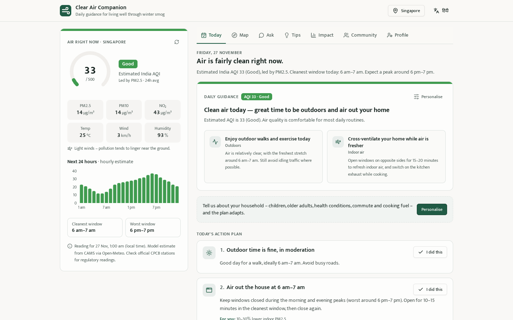
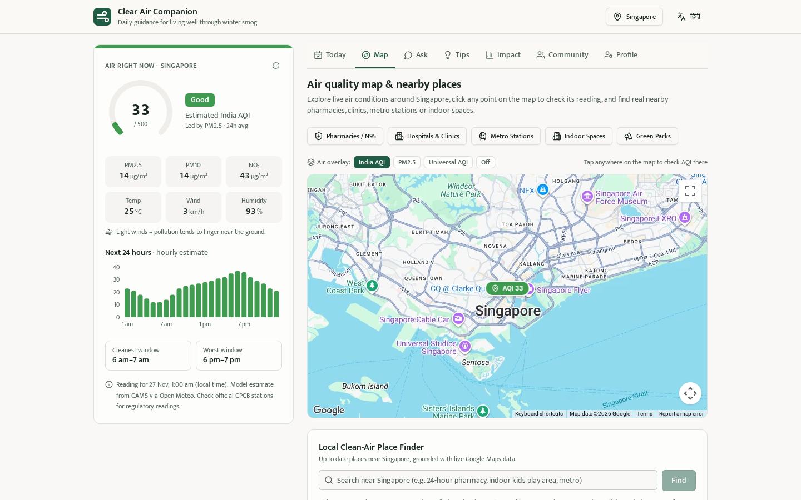
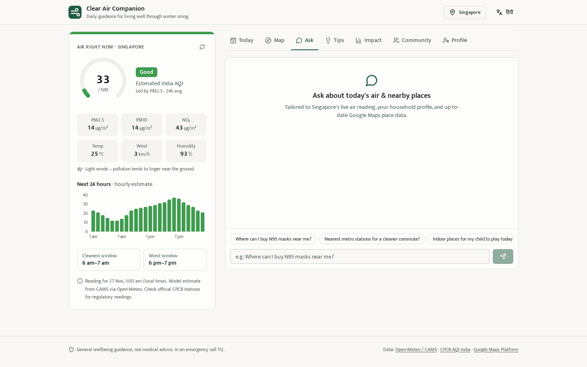
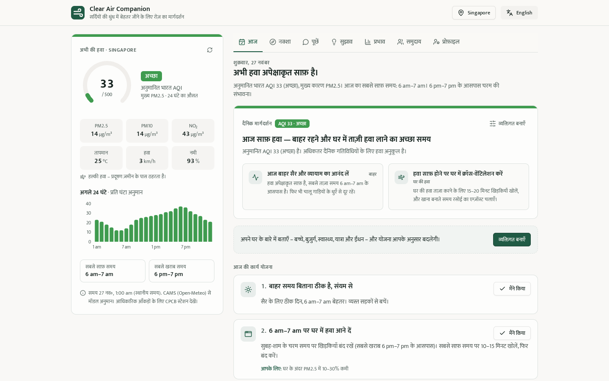

# Clear Air Companion

A friendly bilingual (English & Hindi) assistant that helps families and communities in smog-affected cities live well through severe winter air pollution. It automatically detects your current location, turns live air quality into personalized **Daily Guidance** and a short actionable daily plan, offers an interactive **Air Quality Map & Nearby Place Finder**, and includes a **Google Maps-grounded Q&A assistant**, while explaining what each choice does for your own exposure and for your neighbourhood.

Built from the **Clear Air Companion Project Initiation Document v1.0** (23 November 2026). First launch region: Delhi NCR and the northern India smog belt, with automatic location detection worldwide.

**Live demo:** [mubash-m.github.io/clear-air-companion](https://mubash-m.github.io/clear-air-companion/)



## Screenshots

| Interactive Air Quality Map & Nearby Places | Google Maps-Grounded Q&A Assistant |
| --- | --- |
|  |  |

### Full Bilingual Hindi (`हिंदी`) Experience



## Features

| Area | What it does | PID reference |
| --- | --- | --- |
| Auto-detected air right now | Automatically detects your current location on startup (no hardcoded default city) via browser GPS rounded to ~1 km with Nominatim reverse geocoding and resilient IP geolocation fallback, plus instant city search and one-click re-detection. Displays estimated India AQI (CPCB breakpoints, 24-hour PM2.5/PM10 average), pollutants, weather, 24-hour hourly forecast, and cleanest/worst waking windows with source and reading time. | §4.1, §7, §8.2 |
| Daily Guidance | Personalized health guidance card at the top of Today that adapts to the current AQI category and household profile (e.g., wearing a well-fitted N95 mask on poor+ days, indoor activity timing, and tailored precautions for children, older adults, pregnancy, asthma/heart care, and open commutes). | §6.1 |
| Today's plan | Daily checklist built from the air forecast and household profile: outdoor time, school run, commute, ventilation, cooking, extra care for sensitive members, one budget-fit indoor tip, and one neighbourhood action. | §6.1 |
| Map & Nearby | Interactive Google Map (`@vis.gl/react-google-maps`) with live **Google Air Quality Heatmap** tile overlays (`India AQI`, `PM2.5`, `Universal AQI`), tap-anywhere AQI inspection, **Places API (New)** nearby pins (pharmacies/N95 masks, hospitals & clinics, metro stations, indoor spaces, parks), and a **Local Clean-Air Place Finder** grounded with live Google Maps data and clickable place links. | §6.1, §6.2 |
| Ask | Conversational assistant powered server-side by **Gemini (`gemini-4-hydrogen`) with Google Maps Grounding**, anchored to your active coordinates, live AQI reading, and household profile, with verified Google Maps links and review snippets. Deterministic safety checks run first on every message: breathing emergencies get a fixed response pointing to 112/108, and diagnosis or medicine questions are declined. Household details mentioned in chat automatically update the profile. | §5, §7, §8.1 |
| Tips | Indoor air fixes and sustainable alternatives (travel, cooking, heating, waste, shopping) sorted by cost first, then effect. Each shows what it won't fix, evidence strength, and effect ranges for you and for your neighbourhood. No brands or paid placements. | §6.2, §6.3, §8.4 |
| Impact | Running summary of actions you've taken, with ranges and evidence labels rather than single-number promises. | §6.4 |
| Community | City-aware resident and school group with shared goals (no-idling week, no-burning pledge, carpool days), grouped anonymous questions, and totals. | §6.5 |
| Profile & privacy | Household profile (children, older adults, pregnancy, health conditions, home, commute, fuel, budget), a view of what's stored, and one-click delete. Geolocation is rounded to ~1 km. | §8.3 |
| Languages & Accessibility | Full English and Hindi localization (including `<html lang>` sync), WAI-ARIA keyboard-navigable tabs (`ArrowLeft`/`ArrowRight`/`Home`/`End`), skip-to-main-content link, semantic heading hierarchy, and screen-reader-friendly AQI dial & chart summaries. | §4.1 |

## Architecture & How It Works

- **Full-stack React + Express.** Modular React + TypeScript + Vite + Tailwind CSS + shadcn/ui client under `client/src/` (`Header`, `AirPanel`, `TodayView`, `AirMapView`, `AskView`, `TipsView`, `ImpactView`, `CommunityView`, `ProfileView`, `SafeMarkdown`, `ErrorBoundary`), backed by an Express server in `server.ts` (with validation and security helpers in `server/helpers.ts`) that mounts Vite in dev and serves `dist/public` in production.
- **State management.** Core application state is managed via the `useCompanionState` hook (`client/src/hooks/use-companion-state.ts`) and pure `appStateReducer` (`client/src/lib/appState.ts`), cleanly coordinating automatic location detection, manual city selection precedence, language synchronization, household profile updates, action tracking, and one-click user data clearing.
- **Air and weather data.** Supplied by [Open-Meteo](https://open-meteo.com/en/docs/air-quality-api) (CAMS model data, free, no key). These are model estimates, not official CPCB station readings, and the app labels them that way.
- **India AQI engine.** Calculated in `client/src/lib/air.ts` using CPCB PM2.5 and PM10 breakpoints, waking-hour best/worst window analysis, and privacy-preserving location resolution (`resolveCurrentLocation`).
- **Google Maps Platform.** Powers the interactive map (`@vis.gl/react-google-maps` with `AdvancedMarker` & `InfoWindow`), **Places API (New)** nearby search, and **Air Quality API** heatmap overlays (`client/src/components/AirMapView.tsx`). Server-provided map configuration is served safely via `/api/maps-config`.
- **Gemini API + Maps Grounding.** Runs strictly server-side in `server.ts` (`/api/ask` and `/api/maps-explore`) using `@google/genai` (`gemini-4-hydrogen` with the `googleMaps` tool), with Zod schema validation, per-IP rate limiting, HTTP security headers (`X-Content-Type-Options`, `Referrer-Policy`, `Permissions-Policy`), and safe URL filtering (`http:`/`https:` only).
- **Knowledge library & safety layer.** Live in `client/src/lib/knowledge.ts` and `client/src/lib/companion.ts`. Deterministic emergency (112/108) and medical-refusal safety checks always run before any AI request.
- **Privacy.** Household profile, logged actions, chat history, and group pledges stay in memory in the browser tab. Only approximate coordinates (~1 km) are sent to fetch air readings and local Maps-grounded answers.

## Testing

The project uses **Vitest** with React (`@vitejs/plugin-react`), `@testing-library/react`, and `jsdom` (configured in `vitest.config.ts`), covering 55 unit tests across client hooks, core air quality math, companion guidance, and server security helpers:

- `client/src/__tests__/use-companion-state.test.ts` — `useCompanionState` hook lifecycle, auto-detect vs. manual city precedence, language sync, `appStateReducer`, and ARIA tab keyboard navigation
- `client/src/__tests__/hooks.test.ts` — `useToast` / toast reducer and `useIsMobile` responsive viewport hook
- `client/src/__tests__/air.test.ts` — CPCB India AQI breakpoints, interpolation, category mapping, `fetchAir`, `searchPlaces`, and `resolveCurrentLocation` fallback chain
- `client/src/__tests__/companion.test.ts` — `isSensitive`, `rankedTips`, `buildPlan`, `buildDailyGuidance`, bilingual emergency/medical `safetyCheck`, `extractProfile`, and offline `respond`
- `client/src/__tests__/knowledge-and-ai.test.ts` — bilingual tip library integrity, safe HTTP URL validation, and grounded AI API wrappers
- `server/helpers.test.ts` — Zod payload schemas, prompt sanitization, coordinate validation, Maps source extraction, Gemini error mapping, and rate limiting

## Environment Variables

Copy `.env.example` to `.env` and configure:

- `GEMINI_API_KEY` — Server-side Gemini API key used by `/api/ask` and `/api/maps-explore`.
- `VITE_GOOGLE_MAPS_API_KEY` (or server-side `GOOGLE_MAPS_API_KEY`) — Google Maps Platform API key (restricted to Maps JavaScript API, Places API New, and Air Quality API) for the interactive map canvas and heatmap tiles.

## Run Locally

```bash
npm install
npm run dev         # Express + Vite dev server on http://localhost:3000
npm test            # Run all 55 Vitest unit tests
npm run test:watch  # Run Vitest in watch mode
npm run lint        # TypeScript type check (tsc --noEmit)
npm run build       # Builds client into dist/public
npm start           # Serves production build + API routes via node server.ts
```

## Deployment

- **Full-stack deployment:** Run `npm run build` followed by `npm start` (`node server.ts`), which serves both the compiled SPA and `/api/*` endpoints on port `3000` (or `process.env.PORT`).
- **GitHub Pages (static preview):** Automated via `.github/workflows/deploy.yml` on pushes to `main`.

## Disclaimer

Clear Air Companion gives general wellbeing guidance, not medical advice. In an emergency in India, call 112. Effect estimates are rules of thumb shown as ranges and depend on your home, fit, and how consistently you use them. Community figures in this version are sample data. Use of Google Maps features is subject to the [Google Maps Platform Terms of Service](https://cloud.google.com/maps-platform/terms?utm_campaign=gmp_mcp_codeassist_v1_aistudio).
